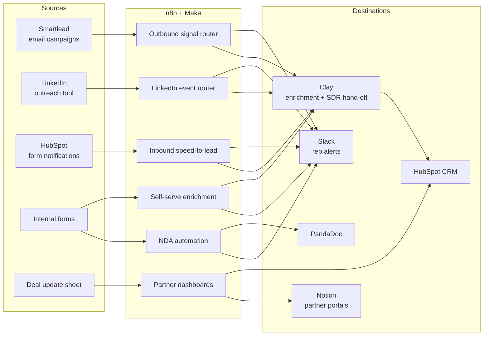

# GTM & RevOps Automation Workflows

[](https://github.com/amjaddwikat/gtm-workflows/actions/workflows/checks.yml)

**I build the systems revenue teams run on.** This repo has production workflows in **n8n** and **Make** for outbound signal routing, inbound speed-to-lead, self-serve enrichment, LinkedIn event follow-up, partner reporting and contract automation, plus **AI lead scoring with Claude, measured against a labeled evaluation set**.

I designed, built, tested and maintained these workflows. The sales team owned the pipeline targets. Each case study covers the revenue problem, the architecture, the failure modes I designed for, **how impact should be measured**, and what I'd change in a rebuild.

## How the pieces fit together



## Case studies

| # | Workflow | Revenue lever | Platform | Case study | Export |
|---|---|---|---|---|---|
| 1 | **Outbound Email Signal Router** | Get positive replies to SDRs fast; keep OOO, alias and bot noise out of their queue | n8n (49 nodes) | [Read](docs/case-studies/01-outbound-email-signal-router.md) | [main](workflows/outbound-email-signal-router.n8n.json) · [regional](workflows/outbound-email-signal-router-regional.n8n.json) |
| 2 | **Inbound Speed-to-Lead** | Route free-trial and whitepaper leads to their owner in seconds, not days | n8n (30 nodes) | [Read](docs/case-studies/02-inbound-speed-to-lead.md) | [json](workflows/inbound-speed-to-lead.n8n.json) |
| 3 | **Self-Serve Apollo → Clay Enrichment** | Turn an Apollo search into an enriched list without manual work; used by 14 people | n8n | [Read](docs/case-studies/03-apollo-self-serve-enrichment.md) | [json](workflows/apollo-self-serve-enrichment.n8n.json) |
| 4 | **LinkedIn Event Outreach Router** | Surface event follow-up replies to the owning SDR | n8n | [Read](docs/case-studies/04-linkedin-event-outreach-router.md) | [json](workflows/linkedin-event-outreach-router.n8n.json) |
| 5 | **Partner Deal Dashboards** | Give each partner live deal visibility without CRM access | Make | [Read](docs/case-studies/05-partner-dashboard.md) | [json](workflows/partner-dashboard.make.json) |
| 6 | **NDA Request → Signature** | Remove days of back-and-forth at the first gate of a deal | n8n | [Read](docs/case-studies/06-nda-automation.md) | [json](workflows/nda-automation.n8n.json) |
| 7 | **AI Lead Scoring (Claude) + Eval** | Tell reps which inbound leads matter, explainably, and alert on unowned high-fit leads | n8n + Claude Haiku 5.5 | [Read](docs/case-studies/07-ai-lead-scoring.md) | [json](workflows/inbound-lead-scorer.n8n.json) · [eval](evals/lead_scoring/leads.jsonl) |

## Patterns used across the workflows

- **Event routers with explicit fallback and error alerts.** Unknown events and failures are reported in Slack with the execution ID, never dropped silently.
- **Configuration in data, not in code.** Rep config, partner registries and routing tables live in sheets and Clay tables, so ops can change behaviour without editing a workflow.
- **Per-lead state to dedupe.** An SDR is notified on the *first* reply or the first meaningful signal, not on every event.
- **Context at hand-off.** Alerts carry the campaign, sequence step, reply text and a CRM link, so the rep can act without searching.
- **Bounded failure handling.** Steps retry a fixed number of times and then alert a human. No infinite loops, no silent drops.
- **Deterministic where possible.** Structured fields are parsed with code, not an LLM. Inbound webhooks that release documents verify the sender's signature.
- **LLMs for judgment, code for arithmetic, evals for trust.** The lead scorer's model picks categories, code computes the score, and a labeled eval set gates every change.

## Quality checks

Every push and pull request runs these checks ([`.github/workflows/checks.yml`](.github/workflows/checks.yml)):

| Check | What it catches |
|---|---|
| [`scripts/check_sanitized.py`](scripts/check_sanitized.py) | Client or prospect data in an export: pinned test data, emails, webhook URLs (Clay and Make URLs *are* credentials), Slack, HubSpot and Sheet IDs, API tokens |
| [`scripts/lint_workflows.py`](scripts/lint_workflows.py) | Broken node references, unknown connection targets, duplicate node names. Its first run found error alerts pointing at a node that didn't exist. |
| [`tests/`](tests/) | Behaviour: every router output wired, no unreachable nodes, no unbounded loops, bot-open filtering, and the Code nodes (HubSpot parser, PandaDoc signature check, lead-scorer request and parser) run in Node.js against fixtures |
| [`evals/run_lead_scoring_eval.py`](evals/run_lead_scoring_eval.py) `--self-check` | The eval's hand labels agree with the scoring code. The **live** eval ([`lead-scoring-eval.yml`](.github/workflows/lead-scoring-eval.yml)) calls Claude on 32 labeled leads and fails below 80% tier accuracy or on any severe mis-tier. |

The tests were written to fail first: run against the pre-hardening exports, 13 of 14 fail, each on a real bug (see the [outbound case study](docs/case-studies/01-outbound-email-signal-router.md#hardening-pass)).

Run locally (Python 3 and Node.js):

```bash
python scripts/check_sanitized.py workflows
python scripts/lint_workflows.py workflows
python -m unittest discover -s tests -v
python evals/run_lead_scoring_eval.py --self-check   # live: set ANTHROPIC_API_KEY and drop the flag
```

## Using these exports

All client, prospect and employee identifiers have been replaced with `YOUR_…` placeholders. To run a workflow:

1. **n8n:** *Workflows → Import from file*, then attach your own credentials (Slack, HubSpot, Google Sheets, IMAP) and replace the placeholders. The NDA flow needs three instance settings for signature verification (see its [case study](docs/case-studies/06-nda-automation.md#security-verifying-the-approval-callback)).
2. **Make:** *Create scenario → ⋯ → Import blueprint*, then reconnect HubSpot, Notion, Google Sheets and Slack.

## Stack

n8n · Make · Smartlead · Clay · HubSpot · Apollo / Apify · LinkedIn automation · PandaDoc · Notion · Google Sheets · Slack · Claude (Anthropic API)

---

Built by **Amjad Dwikat**, GTM Systems & AI Automation Engineer.
