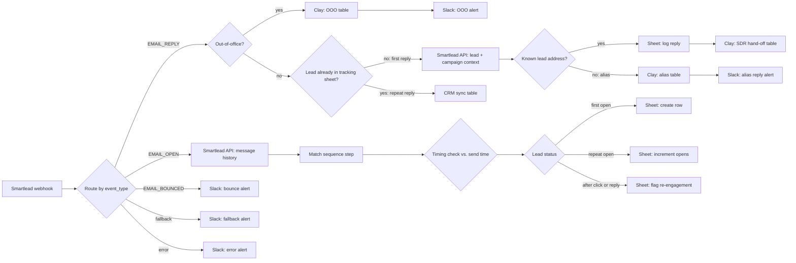

# Outbound Email Signal Router

**Platform:** n8n · **Trigger:** Smartlead webhook (every campaign event) · **Systems:** Smartlead, Google Sheets, Clay, HubSpot (via Clay/Make), Slack
**Files:** [`outbound-email-signal-router.n8n.json`](../../workflows/outbound-email-signal-router.n8n.json) (68 nodes) · [`outbound-email-signal-router-regional.n8n.json`](../../workflows/outbound-email-signal-router-regional.n8n.json) (32 nodes, leaner regional variant)

## The revenue problem

A cold email program creates a lot of events: sends, opens, clicks, replies, bounces. Only a few of them need a human. The expensive failures are:

- **A positive reply that sits unseen** in a shared inbox while the prospect cools off.
- **SDRs chasing noise**: out-of-office auto-replies counted as replies, or "opens" fired by corporate email security scanners.
- **Replies from a different address** than the one emailed (an assistant, a personal alias). These drop out of tracking.
- **No single record** of where each lead stands, so follow-up depends on memory.

This workflow is the layer between the sending tool and the sales team. It classifies every event, keeps a per-lead status record, and sends only the signals that need action to the right place.

## What it does

| Event | Handling |
|---|---|
| **Reply** | Out-of-office replies (Smartlead category 6) go to a dedicated Clay table and a Slack alert, so they can be re-sequenced instead of counted as engagement. A **first** reply is enriched with full lead and campaign context from the Smartlead API, logged, and routed to the SDR hand-off table. A reply from an address Smartlead doesn't recognise is flagged as an **alias reply** for a human to match. Repeat replies from known leads go to the CRM-sync path. |
| **Open** | Pulls the lead's message history from Smartlead to identify which sequence step was opened, applies a timing check against the send timestamp to separate scanner opens from human ones, then records the first open, increments repeat opens, or flags **opens after the lead already clicked or replied** (a re-engagement signal). |
| **Link click** | Logged against the lead's unique tracking ID. Only counted when the lead was in a sent or opened state, to drop scanner clicks, and pushed to SDRs and HubSpot. *(Wired in the regional variant. See "Next iteration".)* |
| **Bounce** | Slack alert with campaign and address, so deliverability problems surface per campaign. |
| **Unknown event / router error** | Separate Slack alerts for fallback and error outputs, with the execution ID for debugging. |

## Architecture

## Design decisions

- **One webhook, one router.** Every Smartlead campaign points at a single endpoint, and routing happens on `event_type`. A new campaign needs no new automation.
- **The sheet holds lead state.** A per-lead row (status, opens, clicks, replies, "sent to SDRs") makes the workflow idempotent at the business level: an SDR is only notified on the *first* reply, however many replies follow.
- **The Smartlead API is used for context, not the webhook payload.** Reply and open events carry very little. Pulling lead and message history gives SDRs the campaign, sequence step and custom fields at hand-off, and tells real leads apart from alias replies.
- **Clay is the hand-off layer.** SDR assignment, enrichment and CRM writes live in Clay tables. Ops can change routing rules without editing the workflow.
- **The router has error and fallback outputs that alert in Slack.** Unknown event types are reported, not silently dropped.

## Failure modes designed for

| Failure | Mitigation |
|---|---|
| OOO auto-replies inflate the reply count | Classified by Smartlead reply category and routed separately |
| Security scanners trigger opens and clicks | Timing check on opens, status gate on clicks |
| Lead replies from a different address | Smartlead lookup miss → alias path with a human alert |
| Duplicate SDR notifications on reply threads | First-reply check against the tracking sheet before routing to SDRs |
| Sheets API throttling under event bursts | Retry on fail plus short waits between dependent reads and writes |
| Unexpected event type or router failure | Dedicated Slack alerts with the execution ID |

## How impact should be measured

The sales team owned pipeline targets. These are the metrics this system is built to move, and where to get them:

- **Reply-to-SDR latency:** time from the Smartlead reply event to the SDR hand-off (n8n execution timestamps).
- **Triage automation rate:** % of replies auto-classified as OOO, alias, first or repeat vs. needing manual sorting.
- **Positive reply → meeting conversion** by campaign (Smartlead categories + HubSpot meetings).
- **Bounce rate per campaign** as a deliverability guardrail (bounce alerts + Smartlead stats).
- **Signal quality:** share of opens and clicks discarded as automated.

## Next iteration

What I would change in a rebuild:

1. **Reconnect the Sent and Link-Click branches** in the main router. The logic exists (and runs in the regional variant) but isn't wired to the router in this export.
2. **Re-verify the bot-open timing check.** Confirm the comparison direction against live Smartlead timestamps and add a test fixture for it.
3. **Replace waits with idempotent upserts.** Fixed delays reduce sheet race conditions but don't remove them. A keyed upsert (`campaign_id + lead_id`) in Postgres or HubSpot would.
4. **Cap retry loops** and send failures to one shared error workflow.
5. **Authenticate the webhook** with a shared-secret header.
6. **Merge the two variants** into one workflow with per-campaign configuration.
