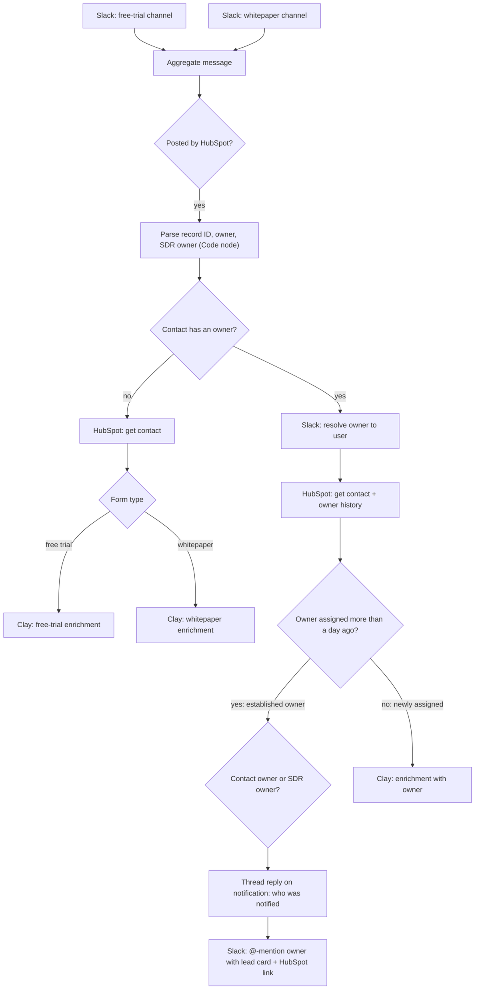

# Inbound Speed-to-Lead Router

**Platform:** n8n · **Trigger:** HubSpot form notifications in Slack (free trial, whitepaper) · **Systems:** HubSpot, Slack, Clay
**File:** [`inbound-speed-to-lead.n8n.json`](../../workflows/inbound-speed-to-lead.n8n.json) (30 nodes)

## The revenue problem

Inbound leads are the most expensive pipeline a company produces, and they decay fastest. A free-trial or whitepaper submission from a contact who **already has an owner** (an account in an open deal, or a prospect an SDR is working) is a high-intent signal. When those submissions land in a shared notification channel, the owning rep often never sees them, and response time stretches to days.

## What it does

1. Listens to the Slack channels where HubSpot posts **free-trial** and **whitepaper** submissions, and ignores any message not posted by HubSpot.
2. Parses the HubSpot record ID, contact owner and SDR owner out of the notification with a small, tested Code node.
3. **Lead already has an owner:** resolves the owner to their Slack user and loads the contact from HubSpot.
   - If the owner relationship is established (assigned more than a day ago), the owner or SDR owner is **@-mentioned in Slack** with name, company, title and a direct HubSpot link. The original notification gets a threaded reply saying who was notified, so the team can see it was handled.
   - If the owner was just assigned, the lead goes to Clay for enrichment with the owner attached.
4. **No owner:** the contact is loaded from HubSpot and sent to the matching Clay enrichment table (free trial or whitepaper).

## Architecture

## Design decisions

- **The lead goes to the owner first, not to the round-robin.** An inbound from a contact someone already owns is a relationship signal, so the person with context hears about it directly.
- **Notifications are closed out in-thread.** The threaded "owner notified" reply turns a noisy channel into an audit trail: you can see which submissions were handled and by whom.
- **Free trial and whitepaper share one pipeline.** Both flows use the same enrichment and routing, with form-specific Clay tables and message templates.
- **Deterministic parsing, not an LLM, for structured fields.** The first version called GPT three times per lead to read fields out of a fixed-format message. A regex does the same job instantly, at no cost, gives the same answer every time, and can be [unit-tested](../../tests/test_workflows.py). Owner names are normalised the way Slack normalises `real_name`, so accented names still match.

## Failure modes designed for

| Failure | Mitigation |
|---|---|
| Non-HubSpot messages in the channel | Bot-author check before any processing |
| Contact with no owner | Separate enrichment path, so no submission is dropped |
| Notification lost in a busy channel | Direct @-mention plus a threaded confirmation |
| HubSpot API hiccups | Retry on fail on HubSpot reads |

## How impact should be measured

- **Speed-to-lead:** median time from form submission to first logged sales activity (HubSpot: create date vs. first engagement).
- **Coverage:** % of inbound submissions that reached a named human within the SLA.
- **Unworked inbound:** % of submissions with no sales activity after 24h.
- **Conversion by path:** owned vs. unowned inbound → meeting → opportunity.

## Next iteration

1. **Trigger from HubSpot directly** (workflow webhook) instead of parsing its Slack notification. That removes the dependency on message formatting.
2. **Match owners by ID, not display name:** HubSpot owner → email → Slack `users.lookupByEmail`.
3. **Add an SLA escalation:** if nobody acts within N minutes, alert the team lead.
4. **Alert someone on unowned leads**, not just enrich them.
5. **Use the LLM where judgement is needed:** score each inbound lead against the ICP and put the score in the rep's alert.
