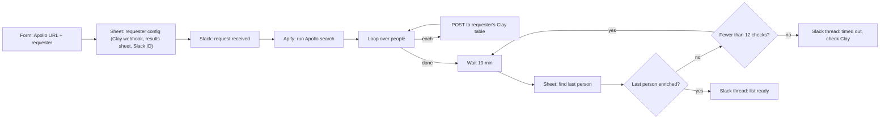

# Self-Serve Apollo → Clay Enrichment

**Platform:** n8n · **Trigger:** n8n form · **Systems:** Apify, Clay, Google Sheets, Slack
**File:** [`apollo-self-serve-enrichment.n8n.json`](../../workflows/apollo-self-serve-enrichment.n8n.json) (11 nodes)

## The revenue problem

Reps build target lists in Apollo, but turning a search into an enriched, sequence-ready list was manual: export, clean, push into the enrichment tool, check results. That costs selling time, and every rep did it slightly differently.

## What it does

A rep submits a form with an **Apollo search URL** and their name. The workflow:

1. Looks up the requester in a config sheet to get **their own Clay table webhook, results sheet and Slack ID**, so each rep's list lands in their own workspace.
2. Confirms in Slack that the request is processing.
3. Runs the Apollo search through an Apify actor and gets the people back.
4. Sends each person to the requester's Clay table for enrichment.
5. Polls the results sheet every 10 minutes until the **last** person from the batch shows up enriched, then replies in the same Slack thread that the list is ready. After 12 checks (2 hours) it stops and tells the rep in the thread that rows may have failed in Clay.

At the time of export the form served **14 people** across the sales team.

## Architecture

## Design decisions

- **Configuration lives in a sheet, not in the workflow.** Adding a rep, or pointing them at a new Clay table, is a sheet edit. No workflow change, no redeploy.
- **Completion is detected on the last record.** Clay enriches asynchronously, so the workflow checks for the final record of the batch in the results sheet before saying "done".
- **Updates go in-thread.** The "processing" and "ready" messages share a Slack thread, so a rep's requests don't clutter the channel.

## How impact should be measured

- **Adoption:** requests per rep per week, and active requesters.
- **Time to list:** form submit → "ready" message (n8n execution times).
- **Manual time removed:** requests × the previous manual handling time per list.
- **Data quality:** enrichment hit rate (email / phone found) per request, from Clay.

## Next iteration

1. **Use a completion webhook from Clay** instead of polling. *(The polling loop is now capped at 2 hours with a timeout message; before, one failed Clay row kept the execution alive forever.)*
2. **Dedupe against the CRM** before enrichment, so credits aren't spent on contacts the team already owns.
3. **Batch the Clay posts** instead of one request per person.
4. **Use a compliant data source.** Swap the Apify scraping step for Apollo's official API or export, in line with the provider's terms of service.
5. **Drive the requester list from SSO or the config sheet** instead of a hard-coded dropdown.
