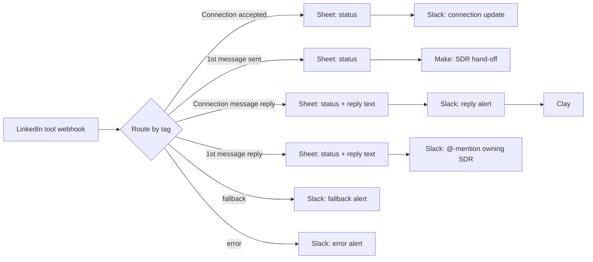

# LinkedIn Event Outreach Router

**Platform:** n8n · **Trigger:** LinkedIn automation tool webhook (Linked Helper) · **Systems:** Google Sheets, Slack, Make, Clay
**File:** [`linkedin-event-outreach-router.n8n.json`](../../workflows/linkedin-event-outreach-router.n8n.json) (13 nodes)

## The revenue problem

In-person events produce a short window of warm attention. Follow-up ran as LinkedIn campaigns (connection request, then a first message), but the responses lived inside the outreach tool. The SDR who owned each lead didn't see a reply until someone checked manually, and there was no shared view of where each attendee stood.

## What it does

The outreach tool fires a webhook on each campaign step, tagged by event type. The workflow keeps one status row per LinkedIn member and routes each event:

| Event tag | Handling |
|---|---|
| Connection request accepted | Update status → Slack update channel |
| First message sent | Update status → hand-off to the SDR workflow (Make) |
| Reply to the connection message | Update status and store the reply text → Slack alert with the reply → Clay |
| Reply to the first message | Update status and store the reply text → **@-mention the owning SDR** with the reply and lead details |
| Unknown tag / router error | Slack fallback or error alert with the execution ID |

## Architecture

## Design decisions

- **Status is keyed on the LinkedIn member ID**, so each event updates one row per person no matter how many campaigns they're in.
- **The reply text goes into the alert.** SDRs can judge intent from Slack without opening the outreach tool.
- **The same router pattern as the email engine** (switch + fallback + error alerts), so the team operates every channel the same way.

## How impact should be measured

- **Acceptance rate** and **reply rate** per event campaign (the status sheet).
- **Reply-to-SDR latency** (webhook time → Slack mention).
- **Event-sourced meetings** booked within N days of the event (HubSpot).

## Next iteration

1. Write status and reply events straight to the CRM timeline instead of a sheet.
2. Authenticate the webhook and add retries on the Slack and Make calls.
3. Fold this into the shared multichannel router with the email engine.

*A lint check added in this repo found that the fallback and error alerts referenced a node name that no longer existed, so the alerts meant to report failures would themselves have failed. That's fixed in this version.*
