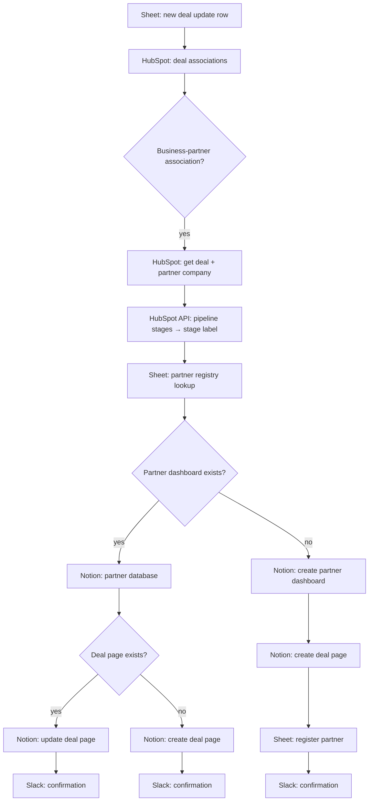

# Partner Deal Dashboards (HubSpot → Notion)

**Platform:** Make · **Trigger:** new row in a Google Sheet · **Systems:** HubSpot CRM, Notion, Google Sheets, Slack
**File:** [`partner-dashboard.make.json`](../../workflows/partner-dashboard.make.json)

## The revenue problem

Partners who source or co-sell deals want to know where *their* deals stand. Giving them CRM access isn't an option, and status emails written by hand go stale and eat RevOps time. Partner trust, and the next referral, depends on that visibility.

## What it does

Each partner gets their **own Notion dashboard** that updates from HubSpot:

1. A new row in the update sheet (deal ID + next steps) triggers the scenario.
2. Associated companies are pulled from HubSpot, keeping only **business-partner associations**.
3. The deal, the partner company and the deal's **pipeline stages** are loaded, and the stage ID is resolved to its readable label.
4. The partner is looked up in a registry sheet:
   - **Known partner:** find the deal's page in their Notion database, then **update** it (stage, amount, last update, next steps) or **create** it.
   - **New partner:** create a new "*Partner* Partner Dashboard" Notion database, add the deal page, and register the partner in the sheet.
5. Every action is confirmed in Slack.

## Architecture

## Design decisions

- **One database per partner.** Each partner can only see their own deals, and access is managed through Notion sharing, not CRM permissions.
- **Create-or-update by HubSpot deal ID.** Re-running the scenario updates a page and never duplicates it.
- **Partners get to onboard themselves.** The first deal from a new partner creates their dashboard automatically.
- **Readable stage names.** Pipeline stage IDs are resolved through the HubSpot API, so partners see "Proposal sent", not an internal ID.

## How impact should be measured

- **Partner coverage:** % of partner-sourced open deals with an up-to-date dashboard page.
- **Freshness:** time between a HubSpot deal change and the Notion update.
- **RevOps time removed:** manual partner status reports no longer written.
- **Partner engagement:** dashboard views and the partner-sourced deal rate over time.

## Next iteration

1. Trigger on HubSpot deal-property changes (webhook) instead of a manual sheet row.
2. Move the partner registry into a HubSpot custom property or object.
3. Add an error route so a Notion or HubSpot failure alerts someone instead of stopping the scenario.
