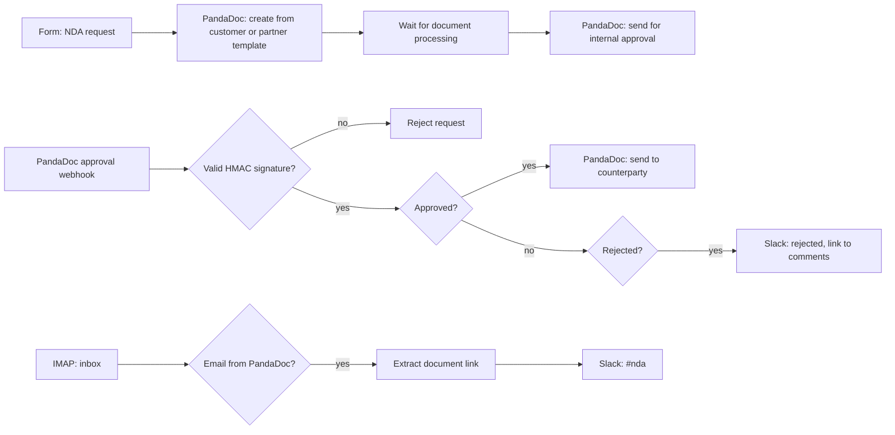

# NDA Request → Signature Automation

**Platform:** n8n · **Triggers:** n8n form, PandaDoc approval webhook, IMAP inbox · **Systems:** PandaDoc, Slack, email
**File:** [`nda-automation.n8n.json`](../../workflows/nda-automation.n8n.json) (13 nodes)

## The revenue problem

An NDA is often the first gate in a deal or partnership. When reps request one by email, legal ops retypes the details into a template and chases approvals, and the deal stalls for days at the very start.

## What it does

1. A rep fills in a form: counterparty, legal address, authorised signatory (name, title, email) and **NDA type** (customer or partner).
2. A PandaDoc document is generated from the **matching template**, with every field filled in through template tokens.
3. The document goes to **internal approval**.
4. When PandaDoc calls back, the workflow first **verifies PandaDoc's HMAC signature**, so a forged "approved" call is rejected. On approval it **sends the NDA to the counterparty** for signature. On rejection it alerts `#nda` with a link to the reviewer's comments.
5. A separate listener watches the inbox for incoming PandaDoc documents, pulls out the "open document" link and posts it to the `#nda` Slack channel.

## Architecture

## Design decisions

- **Template selection by NDA type** keeps the legal language under legal's control. The workflow only fills in the fields.
- **There's an approval gate before anything reaches a counterparty.** Automation speeds up the paperwork without skipping legal review.
- **Incoming NDAs go to one Slack channel**, so they don't get lost in individual inboxes.

## How impact should be measured

- **Cycle time:** request submitted → NDA sent to counterparty → signed (PandaDoc timestamps).
- **Touch time removed** from legal ops per NDA.
- **Error rate:** NDAs re-issued because of wrong details.

## Security: verifying the approval callback

The approval webhook decides whether a legal document goes out, so the workflow trusts only calls PandaDoc signed. PandaDoc appends `?signature=` with an HMAC-SHA256 of the raw request body, keyed with the webhook's shared key ([PandaDoc docs](https://developers.pandadoc.com/docs/webhook-verification)). The **Verify PandaDoc Signature** node recomputes it, compares in constant time, and **fails closed** if the key is missing. Tests cover a valid call, a forged signature, a tampered body and a missing key.

To run it, set these on the n8n instance:

| Setting | Why |
|---|---|
| `PANDADOC_WEBHOOK_KEY` | The shared key from the PandaDoc Developer Dashboard |
| `NODE_FUNCTION_ALLOW_BUILTIN=crypto` | Lets the Code node use Node's `crypto` |
| `N8N_BLOCK_ENV_ACCESS_IN_NODE=false` | Lets the Code node read the key from the environment |
| Webhook node → **Raw Body** on | Already set in the export; the signature covers the exact raw bytes |

## Next iteration

1. **Poll the document status** until it reaches `draft` instead of waiting a fixed 10 seconds.
2. **Notify the requester directly** on rejection (today it goes to `#nda`).
3. Log every request and its status to the CRM against the account.
